# Laporan Testing Menyeluruh — KCS ERP

**Tanggal:** 10 November 2026 · **Versi:** branch `system` · **Penguji:** Claude (pengujian manual lewat browser, seperti pengguna sungguhan)

## Ringkasan

| | |
|---|---|
| Modul diuji | 16 (master data, pembelian, penjualan, persediaan, akuntansi, kas & bank, HRIS, payroll, expense, CRM, task, helpdesk, approval, recurring billing, aset tetap, budget, file, keamanan) |
| Skenario dijalankan | 58 |
| Hasil akhir | **Semua lulus** setelah perbaikan |
| Temuan | 11 (5 bug, 1 risiko kontrol, 3 UX/aksesibilitas, 2 teks) — **semua sudah diperbaiki dan diuji ulang** |
| Laporan keuangan | Neraca saldo, laba rugi dan neraca **cocok dengan hitungan manual** |

## Persiapan: data dummy dikosongkan

1. Backup terenkripsi dibuat dulu: `system/backups/kcs-2026-11-10T13-56-24.dump.enc`.
2. Semua data bisnis dihapus dengan skrip baru `npm run db:reset-data -- --yes`
   (transaksi, customer, supplier, produk, karyawan, tugas, CRM, PDF hasil generate; nomor dokumen kembali ke 1).
3. Yang dipertahankan: perusahaan, akun admin, role & permission, menu, setting, lookup, Chart of Accounts,
   data bawaan template (pajak, satuan, gudang utama, departemen, jabatan, jenis cuti, rekening kas/bank, periode fiskal),
   audit trail, dan file unggahan pengguna.

Semua data pada laporan ini dimasukkan dari nol lewat antarmuka aplikasi.

## Hasil per modul

### 1. Master data
| Skenario | Hasil |
|---|---|
| Buat 2 customer (grup, industri, NPWP, alamat terenkripsi, term NET30/NET14, limit kredit) | ✅ CUS-00001, CUS-00002 |
| Validasi form kosong / email salah | ✅ "Name is required", "Email is not a valid email" |
| Buat 2 supplier | ✅ SUP-00001, SUP-00002 |
| Buat 3 produk (2 barang stok, 1 jasa) dengan harga, pajak, stok minimum | ✅ katalog menampilkan "Out of stock" |
| Buat 3 karyawan (tanggal masuk, jabatan, gaji, rekening; 1 terhubung ke akun admin) | ✅ EMP-00001..3 |
| Set kepala departemen → org chart | ✅ (setelah perbaikan F3) |

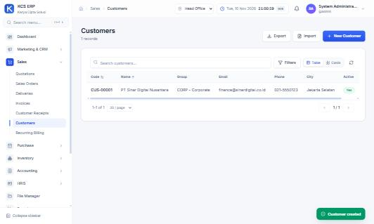 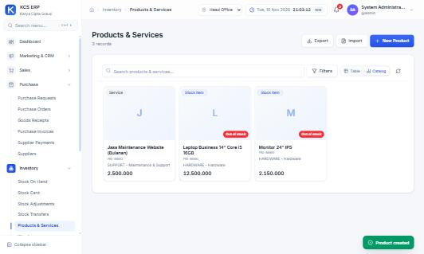 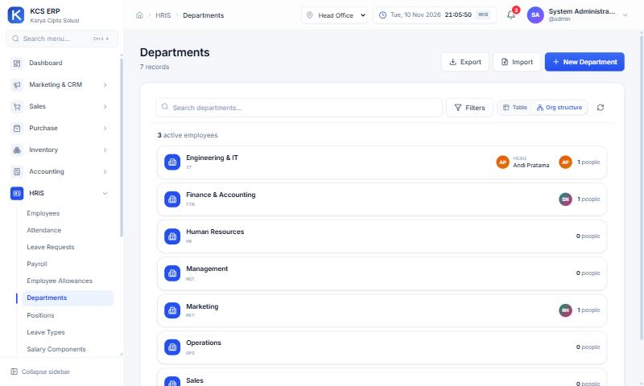

### 2. Pembelian (PO → GR → tagihan → pembayaran)
| Skenario | Hasil |
|---|---|
| PO 5 laptop + 10 monitor | ✅ total 76.035.000 (68,5 jt + PPN 11%) |
| Due date mengikuti term supplier NET30 | ✅ 10 Des 2026 (setelah perbaikan F5) |
| Penerimaan sebagian (3 laptop + 10 monitor) | ✅ GRN/2026/00001, PO "Partial", stok 3 & 10 |
| Penerimaan sisa (otomatis mengusulkan 2 laptop) | ✅ GRN/2026/00002, PO "Completed" |
| Tagihan dari PO | ✅ BILL/2026/11/00001 Unpaid |
| Bayar sebagian 50 jt | ✅ PAY/2026/11/00001, sisa 26.035.000 "Partially paid" |

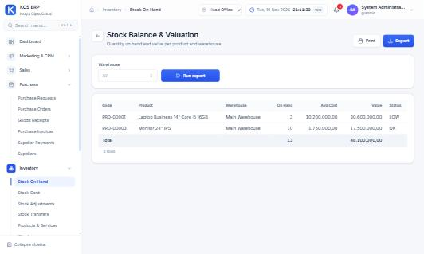

### 3. Penjualan (SQ → SO → DO → invoice → pelunasan)
| Skenario | Hasil |
|---|---|
| Quotation dengan diskon baris 10% | ✅ subtotal 59,3 jt − diskon 2,5 jt + PPN 6.248.000 = **63.048.000** |
| Term NET30 customer terisi otomatis | ✅ |
| Preview PDF quotation | ✅ |
| SO → DO (stok keluar) | ✅ (setelah perbaikan F6) |
| Invoice dari SO (termasuk jasa) | ✅ INV/2026/11/00001 |
| PDF invoice dengan QR tanda tangan digital | ✅ |
| Scan QR (halaman verifikasi) | ✅ "Signature valid", penerbit, nomor, penerima, jumlah |
| Kode QR palsu | ✅ "Not verified" |
| Pelunasan customer | ✅ RCV/2026/11/00001 |

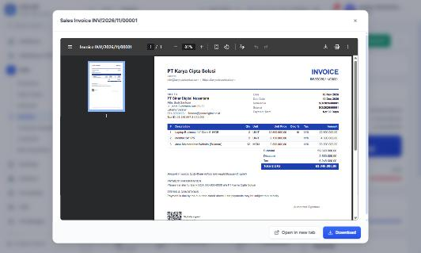 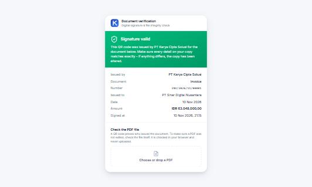 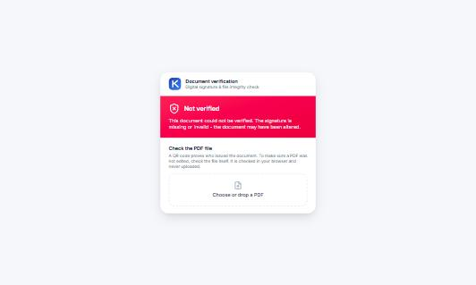

### 4. Akuntansi & laporan
| Pemeriksaan | Hasil |
|---|---|
| 7 jurnal otomatis (GR, tagihan, pembayaran, DO/HPP, invoice, penerimaan) | ✅ HPP DO = 23.900.000 (2×10,2 jt + 2×1,75 jt) |
| Neraca saldo | ✅ debit = kredit = 344.531.000 |
| Persediaan buku = stok fisik | ✅ 44.600.000 |
| Laba rugi | ✅ pendapatan 56,8 jt − HPP 23,9 jt = laba 32,9 jt |
| Neraca | ✅ aset = kewajiban + ekuitas = 65.183.000 |
| Kas keluar (sewa), pembatalan dengan jurnal balik, transfer bank → kas kecil | ✅ CV/2026/11/00002, BT/2026/11/00001 |

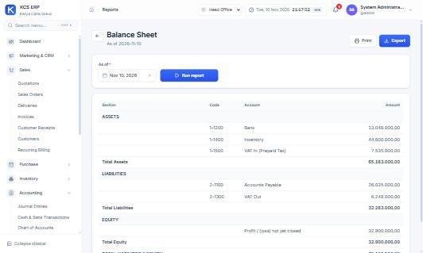 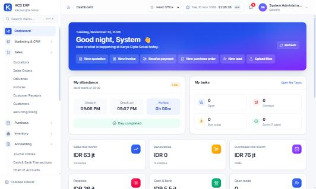

### 5. HRIS, payroll & expense
| Skenario | Hasil |
|---|---|
| Check-in/out mandiri (Late setelah 09:00) | ✅ |
| Grid absensi bulanan: isi sel, "Fill days" 3 karyawan × 6 hari | ✅ 18 record, rata-rata 95,2% |
| Pengajuan & persetujuan cuti, kalender cuti | ✅ |
| Hari cuti dihitung otomatis tanpa akhir pekan & libur | ✅ 23–27 Nov = 4 hari (libur 25 Nov) (perbaikan F8) |
| Payroll November 3 karyawan → konfirmasi & posting | ✅ gross 35,5 jt, net 34.435.000 |
| Expense claim → approve → bayar dari kas kecil | ✅ EXP/2026/11/00001, 1.025.000 |

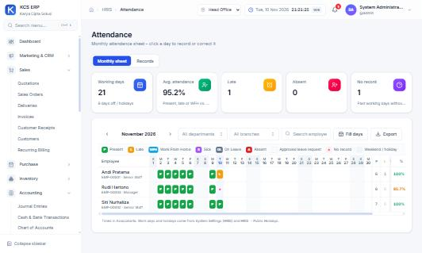 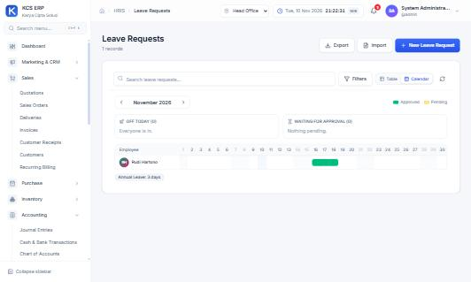

### 6. CRM, task, helpdesk
| Skenario | Hasil |
|---|---|
| Lead → drag ke "Qualified" di kanban | ✅ |
| Opportunity di pipeline (forecast tertimbang 50%) | ✅ 120 jt → 60 jt |
| Aktivitas CRM, task board (TASK-00001) | ✅ |
| Tiket urgent → balasan staf (Open → In progress) → Resolved, "SLA met" | ✅ TCK-00001 |

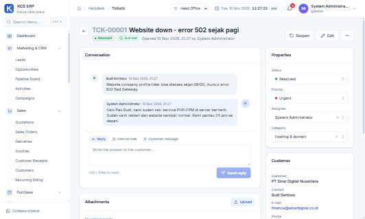

### 7. Approval, recurring billing, aset tetap, budget
| Skenario | Hasil |
|---|---|
| Aturan: SO ≥ 100 jt perlu persetujuan; SO 111 jt tertahan, request → approve → confirm | ✅ (inbox diperbaiki, F9) |
| Langganan maintenance bulanan → invoice otomatis | ✅ INV/2026/11/00002, 2.775.000, jatuh tempo NET30 |
| Aset server 36 jt, 48 bulan: penyusutan Agu–Okt sekaligus | ✅ 3 jurnal × 750.000, nomor per periode (JV/2026/08/00001 …) |
| Budget 2026 → approve → Budget vs Actual | ✅ pendapatan jasa 32,5 jt, gaji 35,5 jt, sewa 7,5 jt cocok |

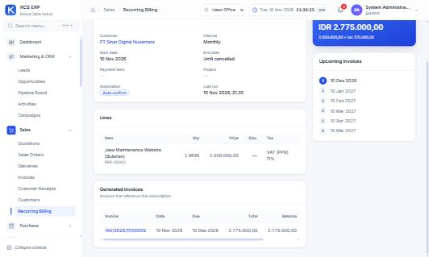 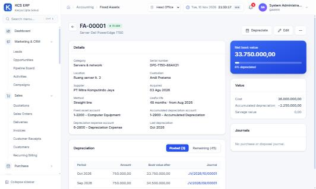 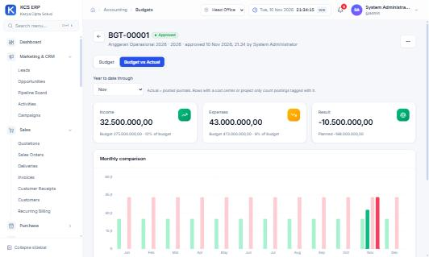

### 8. File, keamanan, sistem, mobile
| Pemeriksaan | Hasil |
|---|---|
| Upload file di File Manager | ✅ |
| Security Center: Argon2id, enkripsi API, Ed25519, enkripsi data | ✅ |
| Verifikasi integritas audit trail (hash chain) | ✅ 160 entri utuh |
| 19 halaman sistem & master data dibuka | ✅ tanpa error |
| Tampilan ponsel (375 px): dashboard & form dokumen | ✅ tanpa scroll ke samping |

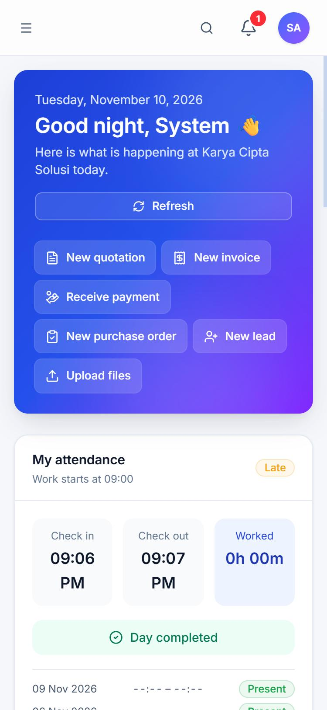 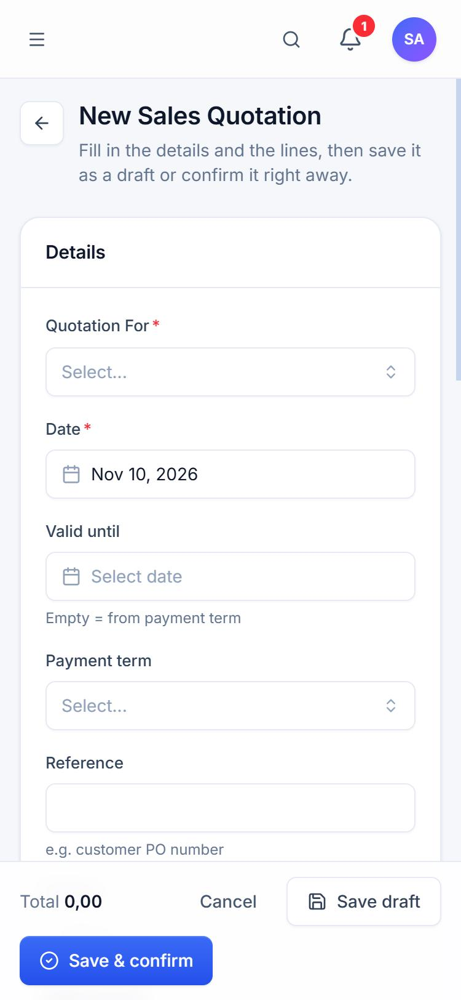

## Temuan & perbaikan

| # | Jenis | Temuan | Perbaikan | Diuji ulang |
|---|---|---|---|---|
| F1 | Aksesibilitas | Label form tidak terhubung ke input (pembaca layar membaca "textbox" tanpa nama) | Setiap `Field` menghubungkan label ke kontrolnya; klik label memfokuskan input | ✅ |
| F2 | Teks | "1 records", "1 people", "1 tasks", "1 invoices" | Bentuk tunggal/jamak yang benar | ✅ "1 record" |
| F3 | Bug | Tampilan khusus (org chart, tree, kartu) tidak ter-refresh setelah simpan / tombol Refresh | Data tampilan ikut di-refresh setelah simpan, hapus, import, Refresh | ✅ |
| F4 | UX | Baris dokumen kosong menggagalkan simpan, hanya dengan toast | Baris yang benar-benar kosong diabaikan | ✅ |
| F5 | **Bug** | Term pembayaran customer/supplier tidak dipakai → jatuh tempo = tanggal dokumen | Server memakai term partner; form mengisinya otomatis | ✅ NET30 → 10 Des |
| F6 | **Bug** | DO dari SO gagal dikonfirmasi "Warehouse is required" padahal hanya ada 1 gudang | Gudang otomatis: gudang cabang atau satu-satunya gudang aktif | ✅ |
| F7 | Risiko kontrol | Kas keluar & jurnal manual bisa diposting ke akun sistem "Current Year Earnings" | Ditolak dengan pesan jelas | ✅ |
| F8 | UX | Jumlah hari cuti harus diketik manual | Dihitung otomatis dari hari kerja, tanpa akhir pekan & libur | ✅ 4 hari |
| F9 | Bug | Inbox approval tidak menampilkan permintaan yang bisa disetujui superadmin, padahal halaman dokumen menampilkannya | Aturan inbox = aturan persetujuan | ✅ |
| F10 | Teks | Security Center mengklaim scan QR membuktikan dokumen "unchanged" | Teks disesuaikan (pemeriksaan file PDF yang mendeteksi perubahan) | ✅ |
| F11 | Bug | Alat "Verify a document" tidak mengenali link QR baru (`?c=`) | Mendukung `?c=` dan `?t=` | ✅ |

## Catatan & yang belum tercakup

- **Kontrol internal:** superadmin boleh menyetujui permintaan/klaimnya sendiri (sesuai desain). Untuk pemisahan tugas,
  gunakan akun non-superadmin bagi staf yang mengajukan.
- **Belum diuji di sesi ini:** pengiriman e-mail (SMTP belum dikonfigurasi), integrasi Hostinger, pembuatan user baru
  (akun & password), multi-perusahaan/cabang, transfer stok (baru ada 1 gudang), stock adjustment, pembayaran gaji ke bank,
  tutup buku akhir tahun, import CSV, watermark PNG, dan scan QR dengan kamera ponsel sungguhan.
  Pemeriksaan file PDF yang diedit sudah diuji sebelumnya lewat API (asli → *Original*, diedit → *Modified*).
- **Data hasil testing** tetap tersimpan sebagai contoh. Untuk mulai bersih lagi: `npm run db:reset-data -- --yes`
  (otomatis membuat backup terenkripsi lebih dulu).
